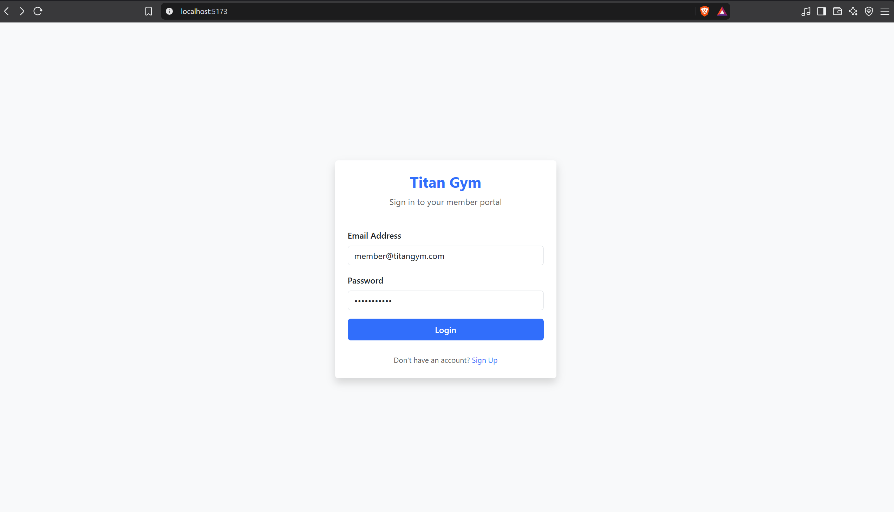
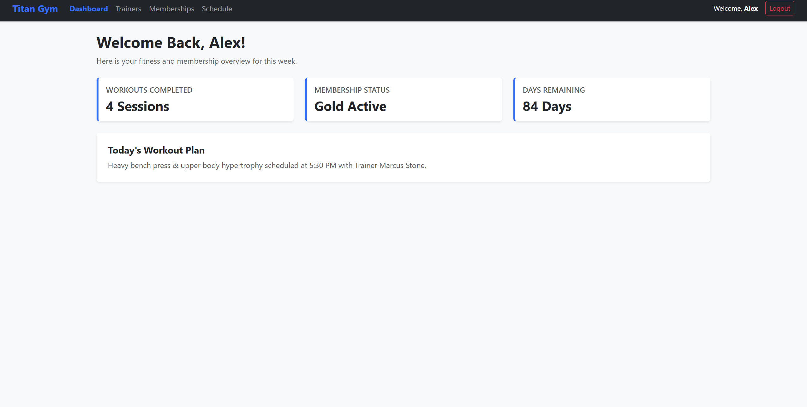
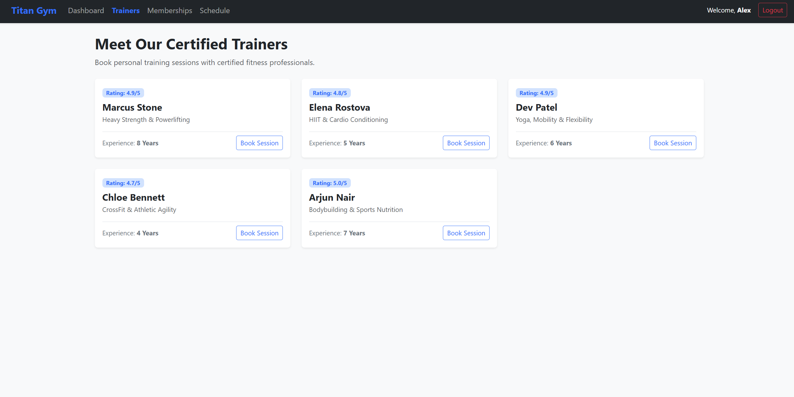

# Assignment 2 - Titan Gym Management Portal

A responsive React Single Page Application built using Vite, React Router, and Bootstrap 5.

## Features
- Client-side routing with nested layouts (`Navbar`, `Footer`, `Outlet`).
- Mock authentication flow with Login and Signup forms.
- Reusable `StatCard` components accepting dynamic title and value props.
- Certified trainer catalog mapped dynamically from structured data arrays.
- Active route highlighting via React Router `NavLink`.

## Screenshots

